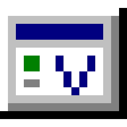
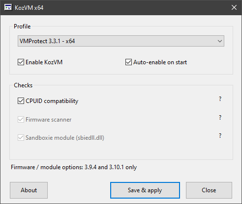
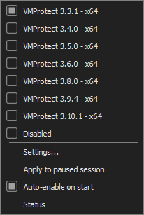
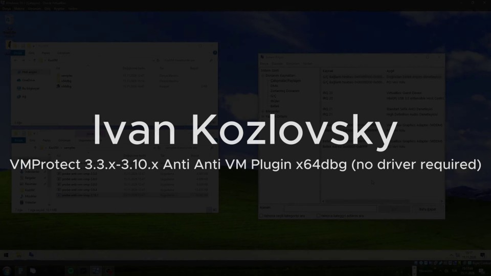

<div align="center">



# KozVM

**VMProtect anti-anti-VM for x64dbg**

Run protected programs inside a VM. Separate profiles for **3.3.1–3.10.1**.

  [](https://github.com/ivanpotatoes/KozVM/releases/latest)

[**Download**](#download) · [Setup](#setup) · [Tested versions](#tested-versions) · [Demo](#demo) · [Research](#research-behind-kozvm)

<br>



</div>

<br>

KozVM grew out of my version-by-version analysis of VMProtect's anti-VM checks. It finds the relevant code in the loaded program and handles the checks under x64dbg, without relying on sample names or fixed addresses.

**No kernel driver or VM-wide configuration changes are required.** The plugin runs in user mode and works on the debugged process.

## Download

| Package | Contents |
| :--- | :--- |
| [**KozVM v1.0 · x64**](https://github.com/ivanpotatoes/KozVM/releases/download/v1.0/KozVM-v1.0-x64.zip) | Plugin, default INI and Unicorn runtime |
| [Source package](https://github.com/ivanpotatoes/KozVM/releases/download/v1.0/KozVM-v1.0-source.zip) | Release sources, including the corresponding Unicorn source archive |

Requires **x64dbg** and the **Microsoft Visual C++ x64 runtime**. Python is only needed when preparing a source build.

**Updating? Keep your existing `KozVM.dp64.ini`.**

## Setup

1. Close x64dbg and copy the ZIP's `plugins` contents into the debugger's `plugins` folder.
2. Keep `KozVM.dp64`, `KozVM.dp64.ini` and the `KozVM` runtime folder together. The runtime folder contains `unicorn.dll` and its license texts.
3. Start x64dbg. Select the matching version under **Plugins → KozVM** before loading the protected executable.
4. Leave **Auto-enable on start** checked, load the program and run it. Check the log for discovery and installation results.

You can change profiles from the menu without opening Settings.

<p align="center">
  
</p>

## Tested versions

| VMProtect | Profile | x64 |
| :--- | :---: | :---: |
| 3.3.1 | `331` | Tested |
| 3.4.0 | `340` | Tested |
| 3.5.0 | `350` | Tested |
| 3.6.0 | `360` | Tested |
| 3.8.0 | `380` | Tested |
| 3.9.4 | `394` | Tested |
| 3.10.1 | `3101` | Tested |

Tests used BasicProbe protected with each listed version. Results apply to those samples and settings; other protected programs may take different paths.

**x32 is not implemented.** The `x32` branch is reserved for future development. `main` contains the published project and `x64` tracks the x64 implementation.

## Checks and settings

| Option | Profiles |
| :--- | :--- |
| CPUID compatibility | All seven tested versions |
| Firmware scanner | 3.9.4 and 3.10.1 |
| Sandboxie module query (`sbiedll.dll`) | 3.9.4 and 3.10.1 |

`KozVM.dp64.ini` stores the selected profile, automatic startup setting and individual options. Each version has its own implementation. Adding an INI entry alone does not add support for another version.

<details>
<summary><strong>How discovery works</strong></summary>

Unicorn executes an isolated snapshot to locate CPUID sites. KozVM then installs hardware breakpoints in the live target. Paths it does not recognize fall back to slower guarded discovery, which is reported in the log.

Available hardware breakpoint slots can affect installation. If startup takes longer than expected or installation fails, check the discovery messages before continuing.

</details>

## Demo

BasicProbe is protected with each VMProtect version, then run **inside VirtualBox** under x64dbg. The video includes protection setup, profile selection and the program running with KozVM enabled.

<p align="center">
  <a href="https://ivankozlovsky.com/uploads/videos/VMProtect-anti-vm-bypass-test-example-video-x64.mp4"></a>
  <br>
  <a href="https://ivankozlovsky.com/uploads/videos/VMProtect-anti-vm-bypass-test-example-video-x64.mp4">Watch the x64 demo</a>
</p>

## Build from source

<details>
<summary><strong>Requirements and build commands</strong></summary>

Use Visual Studio 2022 C++ tools, CMake, Python 3 and the x64dbg SDK.

```powershell
python tools/fetch_unicorn.py
cmake -S . -B build -A x64 -DX64DBG_SDK="C:/path/to/pluginsdk"
cmake --build build --config Release
```

Output: `build/Release/KozVM.dp64` and its `KozVM` runtime directory.

The dependency script downloads pinned Unicorn 2.1.4 runtime and source archives and verifies their SHA-256 hashes.

</details>

[Report a bug](https://github.com/ivanpotatoes/KozVM/issues) with your VMProtect version, protection settings, debugger build and relevant discovery log.

## Research behind KozVM

- [VMProtect 3.3.1 anti-VM analysis](https://ivankozlovsky.com/blog/vmprotect-331-anti-vm-analysis)
- [VMProtect 3.6.x–3.8.x anti-VM analysis](https://ivankozlovsky.com/blog/vmprotect-36x-38x-anti-vm-analysis)
- [VMProtect 3.9.x–3.10.x anti-VM analysis](https://ivankozlovsky.com/blog/vmprotect-39x-310x-anti-vm-analysis)

---

**Ivan Kozlovsky** · [Website](https://ivankozlovsky.com) · [Email](mailto:contact@ivankozlovsky.com) · [PGP](https://ivankozlovsky.com/pgp.asc)

GPLv2. See [LICENSE](LICENSE) and [third-party notices](THIRD_PARTY.md). Release source packages include the corresponding Unicorn source archive.

## Star history

[](https://www.star-history.com/?repos=ivanpotatoes%2Fkozvm&type=date&legend=top-left)
